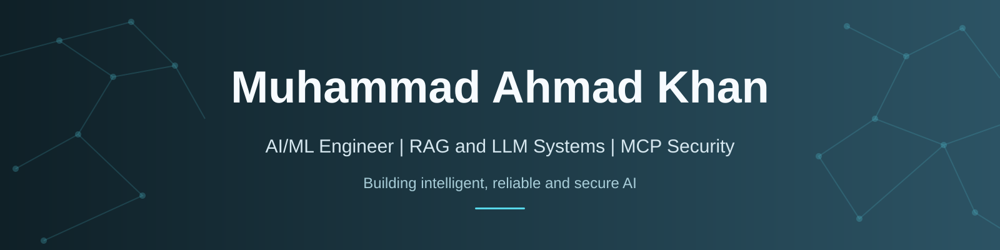

<!-- GitHub profile README | Clean, technical, and readable in light/dark mode -->

<h3>AI/ML Engineer in the Making · RAG &amp; LLM Systems · Agentic AI Security</h3>

Building <strong>useful AI systems</strong> — and studying how to make them <strong>reliable, measurable, and secure</strong>.

  
  
  

---

## About me

I'm a final-year **Computer Science student at UET Peshawar** and an **AI/ML intern at K2X Tech**.

My work sits at the intersection of **applied LLM engineering** and **AI security**: I build retrieval-augmented applications, work with data and backend systems, and research defenses against prompt injection in tool-connected AI agents.

- **Building:** RAG applications, LLM-backed APIs, and practical AI tools
- **Researching:** MCP security, indirect prompt injection, tool-output trust, and adaptive defenses
- **Working with:** Python, local LLMs, retrieval pipelines, full-stack development, and Linux

## Selected projects

<table>
  <tr>
    <td width="50%" valign="top">
      <h3>🛡️ <a href="https://github.com/ahmadkhanraj01/adaptishield_FYP">AdaptiShield</a></h3>
      
<strong>Agentic AI security · FYP research</strong>

      
A layered defense engine for tool-using LLM agents, with prompt-injection screening, causal analysis, policy enforcement, and attack evaluation.

      
<strong>Status:</strong> Core defense pipeline built; web monitoring dashboard planned.

      
<code>Python</code> · <code>Ollama</code> · <code>MCP</code> · <code>Security evaluation</code>

      
<a href="https://github.com/ahmadkhanraj01/adaptishield_FYP">Explore research →</a>

    </td>
    <td width="50%" valign="top">
      <h3>🧠 <a href="https://github.com/ahmadkhanraj01/RAG-UET-Chatbot-Public">RAG-UET Chatbot</a></h3>
      
<strong>Retrieval-augmented generation · Student assistant</strong>

      
Answers university questions from official documents using hybrid retrieval, source metadata, campus-aware filtering, and page-level citations.

      
<strong>Status:</strong> Public demo link available.

      
<code>Python</code> · <code>Streamlit</code> · <code>ChromaDB</code> · <code>BM25</code>

      
<a href="https://github.com/ahmadkhanraj01/RAG-UET-Chatbot-Public">Source code →</a> · <a href="https://rag-uet-chatbot-public.streamlit.app/">Try the demo →</a>

    </td>
  </tr>
  <tr>
    <td width="50%" valign="top">
      <h3>📄 <a href="https://github.com/ahmadkhanraj01/resume-analyzer">Resume Analyzer</a></h3>
      
<strong>Full-stack AI · Career tools</strong>

      
Analyzes resume–role fit, identifies skill gaps, and generates interview preparation material with an API-backed web interface.

      
<strong>Status:</strong> Built and tested locally; deployment pending.

      
<code>FastAPI</code> · <code>React</code> · <code>PostgreSQL</code> · <code>Embeddings</code>

      
<a href="https://github.com/ahmadkhanraj01/resume-analyzer">Explore project →</a>

    </td>
    <td width="50%" valign="top">
      <h3>🐧 <a href="https://github.com/ahmadkhanraj01/SystemServiceMaker">SystemServiceMaker</a></h3>
      
<strong>Linux systems programming · CLI tooling</strong>

      
A C utility that streamlines the setup and management of Linux <code>systemd</code> services, reducing repetitive manual steps.

      
<code>C</code> · <code>Linux</code> · <code>POSIX</code> · <code>systemd</code>

      
<a href="https://github.com/ahmadkhanraj01/SystemServiceMaker">Explore project →</a>

    </td>
  </tr>
</table>

## Tools & technologies

> My main focus is **AI/LLM systems and security**. The rest of the stack supports building, shipping, and testing those systems.

### AI, machine learning & computer vision

  
  
  
  
  

### LLM engineering, retrieval & agent security

  
  
  
  
  

**Practices & research:** `RAG` · `Hybrid search` · `BM25` · `Vector embeddings` · `MCP` · `Prompt-injection defense` · `Red teaming` · `Threat modeling`

### Backend, frontend & databases

  
  
  
  
  
  

### Languages, developer tools & systems

  
  
  
  
  
  
  
  
  

Also experienced with FPGA/embedded systems and Linux system programming.

---

<h3>Let's connect</h3>

Interested in <strong>AI/ML engineering, RAG &amp; LLM systems, and AI security research</strong>.

Open to meaningful collaborations, research discussions, and engineering opportunities.

<a href="https://www.linkedin.com/in/muhammadahmadkhan14aug/">LinkedIn</a> · <a href="mailto:ahmadkhanraj01@gmail.com">Email</a> · <a href="https://github.com/ahmadkhanraj01?tab=repositories">Repositories</a>

